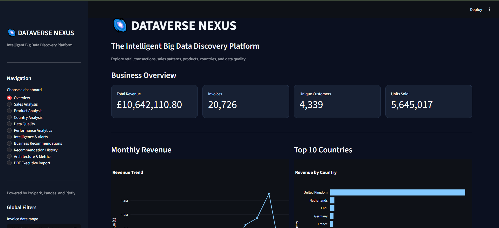
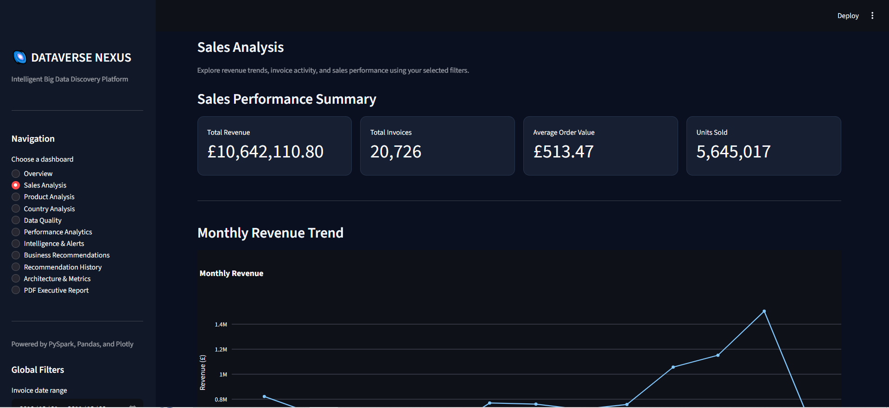
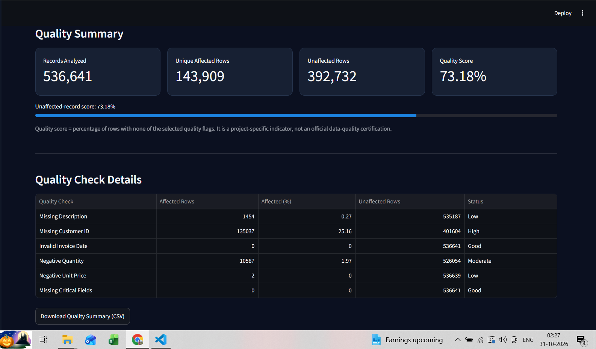
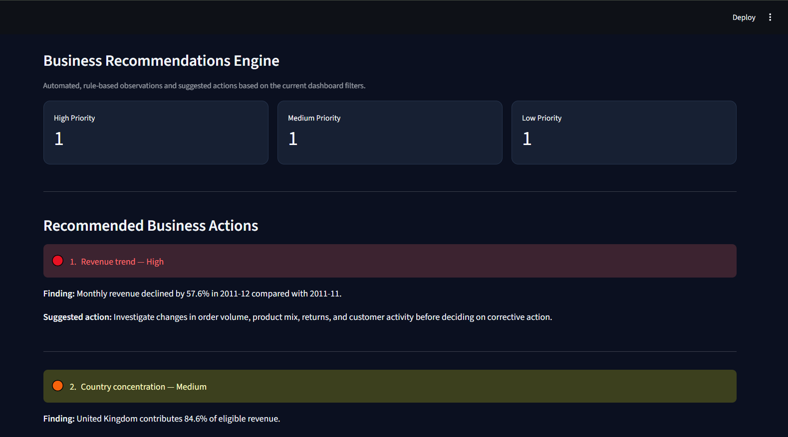
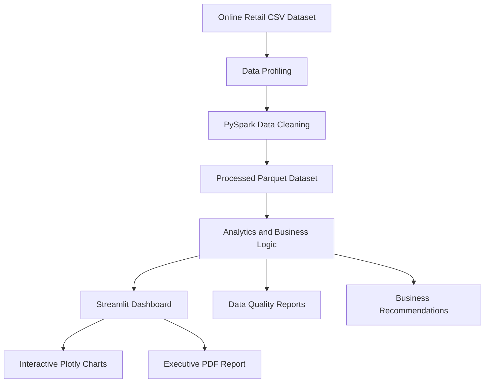

 <div align="center">

# 🚀 DATAVERSE NEXUS

### The Intelligent Big Data Discovery Platform

**From Raw Transactional Data to Actionable Business Intelligence**


[Overview](#-overview) • [Features](#-key-features) • [Architecture](#-system-architecture) • [Screenshots](#-dashboard-screenshots) • [Installation](#-installation-and-setup) • [Demo](#-demo-and-presentation)

</div>

---

## 📌 Overview

**DATAVERSE NEXUS** is an interactive Big Data Analytics platform designed to profile, clean, process, analyze, and visualize large-scale retail transaction data.

The platform combines a PySpark data processing pipeline with an interactive Streamlit dashboard, providing data quality monitoring, business intelligence, advanced visualizations, and actionable business recommendations.

It demonstrates an end-to-end Big Data workflow, transforming raw transactional data into meaningful business insights.

### 🎯 Project Objectives

- Process and analyze large volumes of retail transaction data.
- Identify missing values, duplicate records, and data quality issues.
- Transform raw data into structured, analysis-ready datasets.
- Generate meaningful business insights through interactive dashboards.
- Support data-driven decision-making through analytical recommendations.

## 📊 Dataset Overview

This project uses the **Online Retail dataset**.

| Metric | Value |
|---|---:|
| Original records | 541,909 |
| Original columns | 8 |
| Duplicate records removed | 5,268 |
| Cleaned records | 536,641 |
| Cleaned columns | 16 |
| Dataset | Online Retail CSV |

**Data interpretation:** Negative quantities may represent product returns or credit adjustments. They should not automatically be treated as data-entry errors.

## ✨ Key Features

### 1. Data Profiling
- Dataset overview and structural analysis.
- Column data types and missing-value analysis.
- Duplicate record identification.
- Data profiling reports.

### 2. Big Data Processing
- PySpark-based data cleaning pipeline.
- Data transformation and preprocessing.
- Duplicate record handling.
- Processed data stored in Apache Parquet format.

### 3. Interactive Analytics Dashboard
- Overview dashboard with business KPIs.
- Sales analysis and revenue trends.
- Product performance analysis.
- Country-wise sales analysis.
- Interactive Plotly visualizations.

### 4. Data Quality Monitoring
- Missing-value monitoring.
- Duplicate record analysis.
- Data quality reports.
- Data validation and quality indicators.

### 5. Business Intelligence
- Performance analytics.
- Intelligence and alerts.
- Business recommendations.
- Recommendation history.

### 6. Executive Reporting
- Generate executive-style PDF reports.
- Present important business metrics.
- Summarize analytical findings.

## 🖥️ Dashboard Screenshots

### Overview Dashboard



### Sales Analysis



### Data Quality



### Business Recommendations



## 🏗️ System Architecture



## 🧰 Technology Stack

| Category | Technologies |
|---|---|
| Programming Language | Python |
| Big Data Processing | Apache Spark, PySpark |
| Data Manipulation | Pandas, NumPy |
| Dashboard Development | Streamlit |
| Data Visualization | Plotly |
| Reporting | ReportLab, Matplotlib |
| Data Storage | CSV, Apache Parquet |
| Testing | pytest |
| Development Environment | VS Code |

## 📁 Project Structure

```text
DATAVERSE_NEXUS/
│
├── app.py
├── requirements.txt
├── README.md
├── .gitignore
│
├── engine/
│   ├── __init__.py
│   ├── pipeline.py
│   ├── cleaning.py
│   ├── business_recommendations.py
│   └── recommendation_history.py
│
├── data/
│   ├── raw/
│   └── processed/
│
├── reports/
│   ├── data_profile.json
│   ├── data_quality_report.json
│   └── recommendation_history.json
│
├── assets/
│   └── screenshots/
│       ├── overview.png
│       ├── sales-analysis.png
│       ├── data-quality.png
│       └── recommendations.png
│
└── tests/
    ├── test_business_recommendations.py
    ├── test_cleaning.py
    ├── test_pipeline.py
    └── test_recommendation_history.py
```

## ⚙️ Installation and Setup

### Prerequisites

Make sure you have installed:

- Python 3.11
- Java Development Kit (JDK) 17
- Git
- Visual Studio Code (recommended)

For Windows, PySpark may also require compatible Hadoop utilities (`winutils.exe` and `hadoop.dll`).

### Step 1: Clone the Repository

```bash
git clone https://github.com/TirthPatel8267/dataverse-nexus.git
```

```bash
cd dataverse-nexus
```

### Step 2: Create a Virtual Environment

```powershell
py -3.11 -m venv .venv
```

Activate it:

```powershell
.\.venv\Scripts\Activate.ps1
```

### Step 3: Install Dependencies

```bash
python -m pip install --upgrade pip
```

```bash
pip install -r requirements.txt
```

### Step 4: Configure Java and Hadoop

Configure the environment variables in PowerShell.

Replace the Java path with your actual Java 17 installation directory.

```powershell
$env:JAVA_HOME = "C:\path\to\jdk-17"
$env:HADOOP_HOME = "C:\hadoop"
$env:Path = "$env:JAVA_HOME\bin;$env:HADOOP_HOME\bin;$env:Path"
```

### Step 5: Prepare the Dataset

Ensure the source dataset is available at:

```text
data/raw/Online Retail.csv
```

### Step 6: Run the Data Pipeline

```bash
python -m engine.pipeline
```

```bash
python -m engine.cleaning
```

### Step 7: Launch the Dashboard

```bash
streamlit run app.py
```

Open the local URL provided by Streamlit, usually:

```text
http://localhost:8501
```

### Step 8: Run Automated Tests

```bash
python -m pytest -q
```

## 🎬 Demo and Presentation

**Project Demonstration:** Add your recorded dashboard walkthrough link here.

**PowerPoint Presentation:** Add your final five-slide project presentation here.

**Executive PDF Report:** Add a reviewed sample executive report here.

### Suggested Demo Flow

1. Introduce DATAVERSE NEXUS.
2. Demonstrate the Overview dashboard.
3. Explore Sales and Product Analysis.
4. Explain Data Quality monitoring.
5. Demonstrate Business Recommendations.
6. Show Executive PDF Report generation.

## 🧪 Testing

The project includes automated tests in the `tests/` directory.

Execute the test suite using:

```bash
python -m pytest -q
```

## 🔮 Future Enhancements

- Real-time data ingestion and processing.
- Predictive sales analytics using Machine Learning.
- Advanced customer segmentation.
- Automated business intelligence alerts.
- Cloud-based deployment.
- Interactive forecasting and trend prediction.

## ⚠️ Notes and Limitations

- Large CSV and Parquet files may increase repository size.
- Review dataset redistribution permissions before publishing raw data.
- Generated reports should be checked before public sharing.
- Recommendations and anomaly indicators are analytical outputs, not guaranteed predictions.
- Java and Hadoop configuration may vary across operating systems.

## 📄 License

No open-source license has been selected for this project yet. Add a `LICENSE` file if you wish to specify reuse and distribution permissions.

---

<div align="center">

### 🚀 DATAVERSE NEXUS

**Turning Data Into Discovery.**

Developed as a Big Data Analytics Academic Project.

⭐ If you find this project interesting, consider giving the repository a star!

</div>
