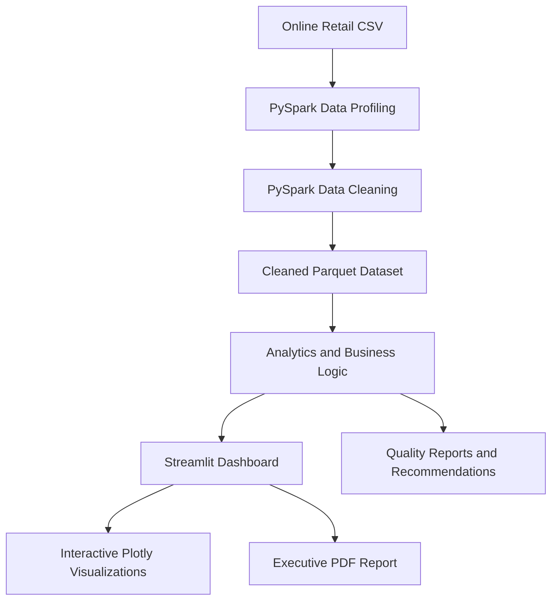

🚀 DATAVERSE NEXUS
The Intelligent Big Data Discovery Platform
From raw transactional data to actionable business intelligence.

Overview · Features · Architecture · Installation · Demo

Overview
DATAVERSE NEXUS is an interactive Big Data Analytics platform designed to profile, clean, analyze, and visualize retail transaction data. It combines a PySpark processing pipeline with a Streamlit dashboard, interactive visualizations, data quality reporting, and business recommendations.

This project uses the Online Retail dataset to demonstrate a practical workflow from raw CSV data to cleaned Parquet storage and business-facing insights.
Dataset at a glance
Metric	Value
Raw records	541,909
Raw columns	8
Exact duplicate rows removed	5,268
Cleaned records	536,641
Cleaned columns	16
Source	Online Retail CSV

Data interpretation: Negative quantities can represent returns or credit adjustments; they are not automatically data-entry errors. The dashboard's revenue metrics should be interpreted according to the applicable transaction filters.

Features
- Data profiling: Explore dataset size, column types, missing values, and duplicate records.
- PySpark cleaning pipeline: Transform raw retail transactions into analysis-ready data.
- Parquet storage: Save processed data in a columnar format for downstream analytics.
- Interactive dashboard: Explore overview metrics, sales, products, and countries.
- Data quality monitoring: Inspect quality checks and data completeness.
- Performance analytics: Examine revenue trends and performance indicators.
- Intelligence and alerts: Surface unusual patterns and business signals.
- Business recommendations: Present data-informed recommendations and review their history.
- Executive reporting: Generate an executive-style PDF report from the dashboard, where configured.
Dashboard screenshots
Add your own screenshots from the running Streamlit application. Do not substitute mockups for real outputs.

Overview	Sales Analysis
	

Data Quality	Business Recommendations
	

Architecture

Project structure
DATAVERSE_NEXUS/
├── app.py                         # Streamlit application
├── engine/                        # Processing and business logic
│   ├── pipeline.py
│   ├── cleaning.py
│   ├── business_recommendations.py
│   └── recommendation_history.py
├── data/
│   ├── raw/                       # Source dataset
│   └── processed/                 # Cleaned Parquet data
├── reports/                       # Quality, profile, and history outputs
├── tests/                         # Automated tests
├── assets/
│   └── screenshots/               # README screenshots (to be added)
├── requirements.txt
└── README.md
Technology stack
Layer	Technologies
Programming	Python
Big data processing	Apache Spark / PySpark
Data manipulation	Pandas, NumPy
Dashboard	Streamlit
Interactive charts	Plotly
Reporting and plotting	ReportLab, Matplotlib
Storage	CSV, Apache Parquet
Testing	pytest

Installation and running
Prerequisites
- Python 3.11 recommended for the project's tested setup.
- Java 17 for the local PySpark runtime.
- On Windows, the local Spark/Hadoop setup may require compatible winutils.exe and hadoop.dll and a configured HADOOP_HOME.
1. Clone the repository
git clone https://github.com/TirthPatel8267/dataverse-nexus.git
cd dataverse-nexus
2. Create and activate a virtual environment
py -3.11 -m venv .venv
.\.venv\Scripts\Activate.ps1
3. Install dependencies
python -m pip install -r requirements.txt
4. Configure Java and Hadoop (Windows)
Configure JAVA_HOME to your installed Java 17 directory and HADOOP_HOME to your Hadoop utilities directory. For example, replace these placeholders with your own paths:
$env:JAVA_HOME = "C:\path\to\jdk-17"
$env:HADOOP_HOME = "C:\hadoop"
$env:Path = "$env:JAVA_HOME\bin;$env:HADOOP_HOME\bin;$env:Path"
5. Prepare the data
Ensure the source CSV is present at data/raw/Online Retail.csv if the dataset is not included in your clone. To regenerate pipeline outputs, run:
python -m engine.pipeline
python -m engine.cleaning
6. Launch the dashboard
streamlit run app.py
Streamlit will print the local URL in the terminal (commonly http://localhost:8501).
7. Run tests
python -m pytest -q
Demo and presentation
- Demo video: Add a link to your screen-recorded walkthrough.
- Five-slide project presentation: Add the final PPTX file or a link after it is ready.
- Executive PDF report: Add a sample report after reviewing it for accuracy and sensitive content.
Suggested demo flow (about 2 minutes): Open the dashboard → show Overview → explore Sales and Product Analysis → review Data Quality → show Business Recommendations → demonstrate PDF reporting.
Notes and limitations
- Large raw CSV and Parquet files increase repository size. If they are removed from Git, document how to obtain or regenerate them.
- Recommendations and anomaly indicators are analytics outputs, not guaranteed predictions.
- Screenshot placeholders above will show as missing images until the referenced files are committed.
License
No license has been selected yet. Add a LICENSE file if you want to specify reuse permissions.