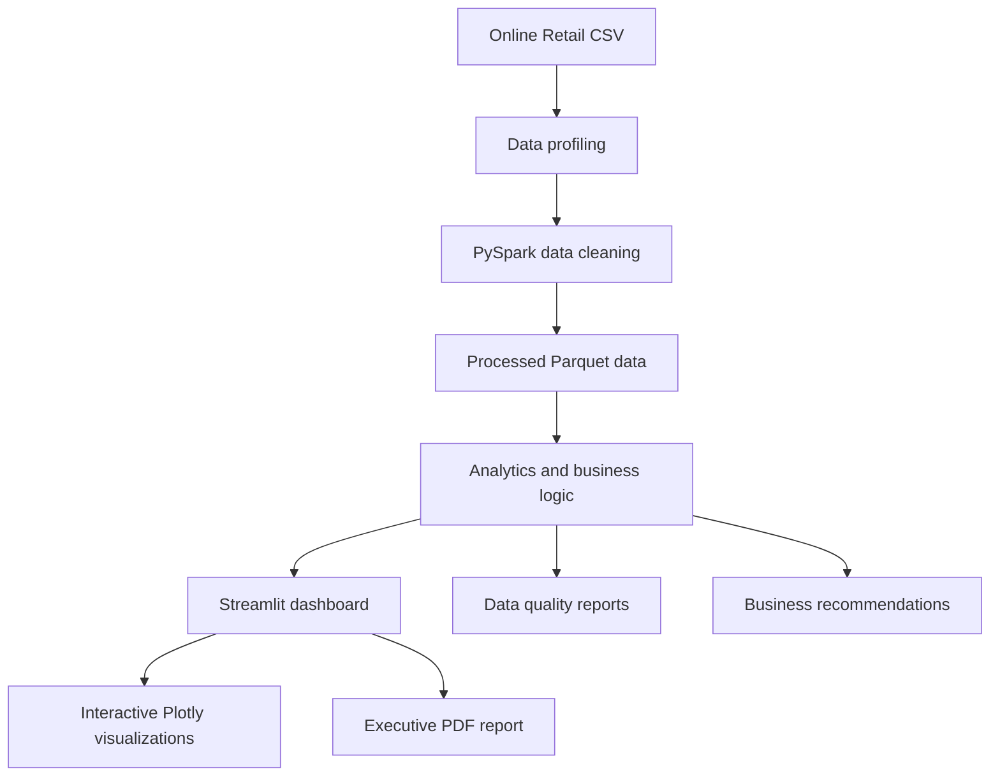

🚀 DATAVERSE NEXUS
The Intelligent Big Data Discovery Platform
From raw transactional data to actionable business intelligence.

Overview · Features · Architecture · Screenshots · Installation · Demo

📌 Overview
DATAVERSE NEXUS is an interactive Big Data Analytics platform built to profile, clean, process, analyze, and visualize retail transaction data.

The project demonstrates an end-to-end analytics workflow: raw CSV ingestion, data profiling, PySpark-based cleaning, Parquet storage, business analysis, and interactive exploration through a Streamlit dashboard. It also provides data-quality reporting and business recommendations to help users interpret the dataset.

The project uses the Online Retail dataset as its working example.
📊 Dataset at a glance
Metric	Value
Raw records	541,909
Raw columns	8
Exact duplicate rows removed	5,268
Cleaned records	536,641
Cleaned columns	16
Source file	Online Retail.csv

Data interpretation: Negative quantities may represent product returns or credit adjustments. They should not automatically be treated as data-entry errors. Revenue and other business metrics should be interpreted using the transaction filters applied by the analysis.

✨ Key features
- Data profiling: Inspect dataset dimensions, column information, missing values, and duplicate records.
- PySpark data processing: Run the data preparation and cleaning workflow using Apache Spark.
- Parquet output: Store processed data in a columnar format for downstream analysis.
- Interactive dashboard: Explore key metrics and analyze sales, products, and countries.
- Data quality monitoring: Review missing values, duplicates, and other quality indicators.
- Performance analytics: Explore revenue trends and business performance indicators.
- Intelligence and alerts: Review unusual patterns and analytical signals.
- Business recommendations: View data-informed recommendations and recommendation history.
- Executive reporting: Generate an executive-style PDF report from the dashboard.
🖥️ Dashboard screenshots
The screenshots below should be captured from the running application. Replace or update the images whenever the dashboard changes.

Overview
Sales analysis
Data quality
Business recommendations

🏗️ System architecture
The following diagram summarizes the main processing and presentation flow.

🧰 Technology stack
Layer	Technologies
Programming language	Python
Big data processing	Apache Spark, PySpark
Data manipulation	Pandas, NumPy
Dashboard	Streamlit
Interactive visualization	Plotly
Reporting and plotting	ReportLab, Matplotlib
Data storage	CSV, Apache Parquet
Testing	pytest

📁 Project structure
DATAVERSE_NEXUS/
│
├── app.py                         # Streamlit dashboard
├── requirements.txt               # Python dependencies
├── README.md                      # Project documentation
├── .gitignore
│
├── engine/
│   ├── __init__.py
│   ├── pipeline.py                # Data profiling / pipeline
│   ├── cleaning.py                # PySpark cleaning workflow
│   ├── business_recommendations.py
│   └── recommendation_history.py
│
├── data/
│   ├── raw/                       # Source dataset
│   └── processed/                 # Processed Parquet output
│
├── reports/                       # Generated profile and quality reports
│
├── assets/
│   └── screenshots/               # Dashboard screenshots
│
└── tests/                          # Automated tests
⚙️ Installation and setup
1. Clone the repository
git clone https://github.com/TirthPatel8267/dataverse-nexus.git
cd dataverse-nexus
2. Create a virtual environment
Windows PowerShell:
py -3.11 -m venv .venv
.\.venv\Scripts\Activate.ps1
3. Install dependencies
python -m pip install --upgrade pip
pip install -r requirements.txt
4. Configure Java and Hadoop on Windows
The local PySpark setup requires a compatible Java installation. This project was developed with Java 17.

Set the following environment variables in the current PowerShell session. Replace the Java path if Java 17 is installed elsewhere.
$env:JAVA_HOME = "C:\path\to\jdk-17"
$env:HADOOP_HOME = "C:\hadoop"
$env:Path = "$env:JAVA_HOME\bin;$env:HADOOP_HOME\bin;$env:Path"
For a Windows Spark environment, compatible Hadoop utility files such as winutils.exe and hadoop.dll may also be required. Do not commit these binaries to this repository.
5. Add the source dataset
Place the Online Retail CSV file at:
data/raw/Online Retail.csv
If the dataset is not included in your local clone, obtain it from the original dataset source and place it at the path above before running the pipeline.
6. Run the data pipeline
Run the project modules from the repository root:
python -m engine.pipeline
python -m engine.cleaning
7. Launch the Streamlit dashboard
streamlit run app.py
Open the local URL printed in the terminal (usually http://localhost:8501).
8. Run the tests
python -m pytest -q
🎬 Demo and presentation
- Demo video: Add a link to your recorded dashboard walkthrough here.
- Project presentation: Add the final five-slide PowerPoint file or a link here.
- Executive report: Add a reviewed sample PDF report here, if it is appropriate to share.
Suggested two-minute demo flow:
1. Open the dashboard and introduce the project.
2. Show the Overview page and key metrics.
3. Explore Sales Analysis and Product Analysis.
4. Demonstrate the Data Quality page.
5. Show Business Recommendations and the PDF reporting feature.
🧪 Testing
Automated tests are maintained in the tests/ directory. Run the test suite using:
python -m pytest -q
Use the latest test output as the source of truth when reporting the test count or test status.
⚠️ Notes and limitations
- The raw CSV and processed Parquet files can make a Git repository large. Include them only if their size and redistribution terms are suitable. Otherwise, document how to obtain or regenerate them.
- Generated reports may contain dataset-specific results. Review them before publishing.
- Recommendations and anomaly indicators are analytical outputs; they are not guaranteed predictions.
- The Java and Hadoop configuration shown above is for a local Windows setup. Paths and requirements may differ on other operating systems.
📄 License
No license has been added yet. Unless a license is included, others do not automatically receive permission to reuse, modify, or distribute this project. Add a LICENSE file if you intend to publish it under an open-source license.

DATAVERSE NEXUS — Turning data into discovery.

Built as a Big Data Analytics academic project.

